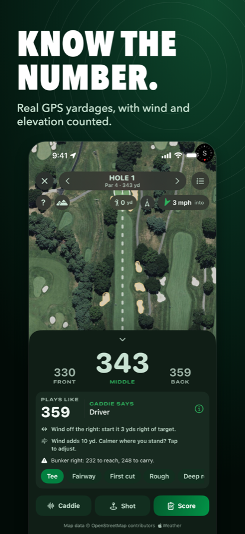
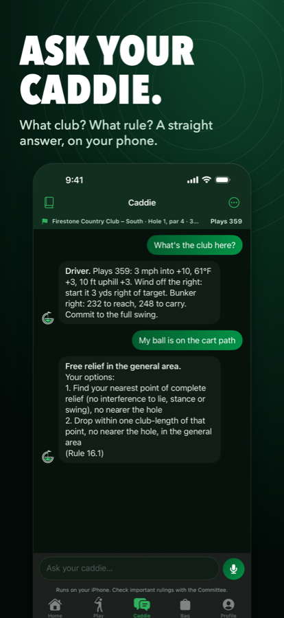
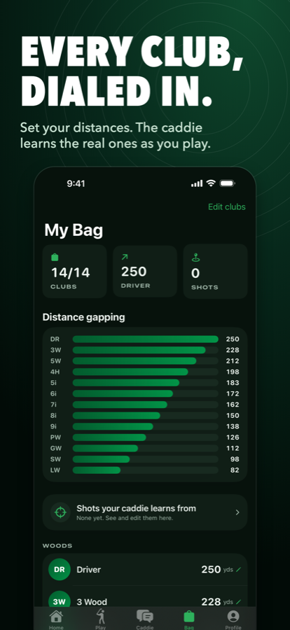
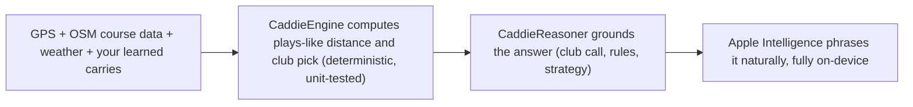

  
  <h1>GolfCaddie</h1>

  
<strong>Your personal golf assistant.</strong>

     

> **Showcase repository.** The source code for GolfCaddie is not published. This page presents what the product is and how it works.

## Screenshots

  
  
  

<a href="docs/media/golfcaddie-motion-ad-dark.mp4"><b>▶ Watch the 20-second motion ad</b></a> (dark mode)

## Overview

An AI caddie for iPhone that knows your game, reads wind and elevation, and talks you through every shot by voice or text. Club selection is deterministic math; the language model only handles the human side.

## How it works

## Features

- Rangefinder with plays-like distance (wind, temperature, altitude, elevation, lie)
- Round screen: satellite hole view, front/middle/back, tap-to-target, hazard carries, shot tracking, scoring
- Conversational caddie with hold-to-talk voice and optional spoken replies
- Plain-language rulebook covering all 25 Rules of Golf plus a strategy playbook
- Bag management that learns your real carry distances
- Tournament Mode, handicap and scoring stats, Apple Watch companion target
- Auto-loaded hole maps from OpenStreetMap; offline-capable

## Tech stack

| Layer | Choice |
|---|---|
| Language / UI | Swift, SwiftUI, iOS 17+, Xcode 26 |
| AI | Apple Intelligence (on-device) + deterministic engine |
| Data | MapKit, OpenStreetMap, WeatherKit, Open-Meteo elevation |
| Platforms | iPhone + Apple Watch target |
| Backend | None in v1 (CloudKit foundation paused) |

## Privacy & security

Nothing leaves the phone for the caddie. No account in v1.

## Brand

| | Name | Hex | Role |
|---|---|---|---|
|  | Forest | `#035229` | Primary / text |
|  | Fairway | `#029447` | Accent |
|  | Grass | `#38B34A` | Highlights |
|  | Mint | `#C8E2D2` | Light surfaces |

**Mark.** Condensed heavy GOLFCADDIE wordmark; display type echoes it, numbers in SF Rounded with monospaced digits.

**Voice.** Direct, calm and confident, like a good caddie: the number, the club, the reason.

## Roadmap

- Friends & social feed (needs backend + moderation)
- Apple Watch yardages with wrist tap
- Green reading and pin position
- Strokes Gained analytics
- Android
- Downloadable on-device model for non-Apple-Intelligence iPhones

## Notes

Marketing assets (launch kit, ads, videos, landing page) are kept in a separate private folder, not in this repo.

## License

Proprietary. Shared publicly for portfolio and demonstration purposes only. See [LICENSE](LICENSE).

---

Built by [Aquila Digital LLC](https://github.com/Steven6Brown) · *Per Aspera Ad Astra*

